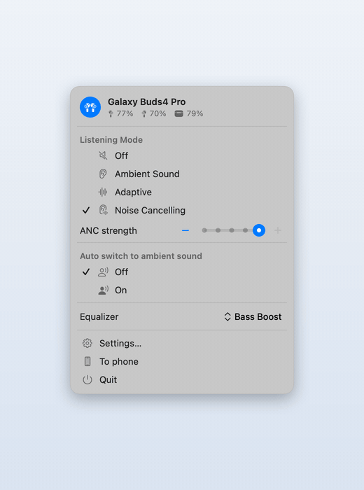
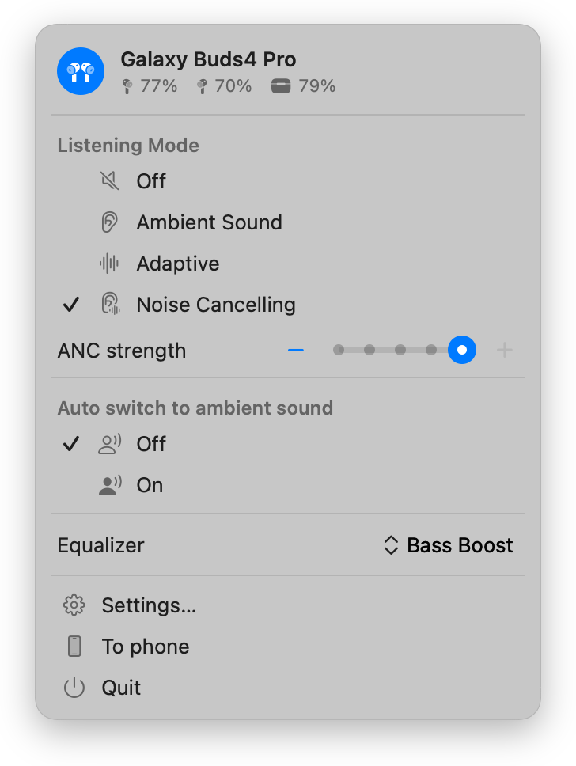
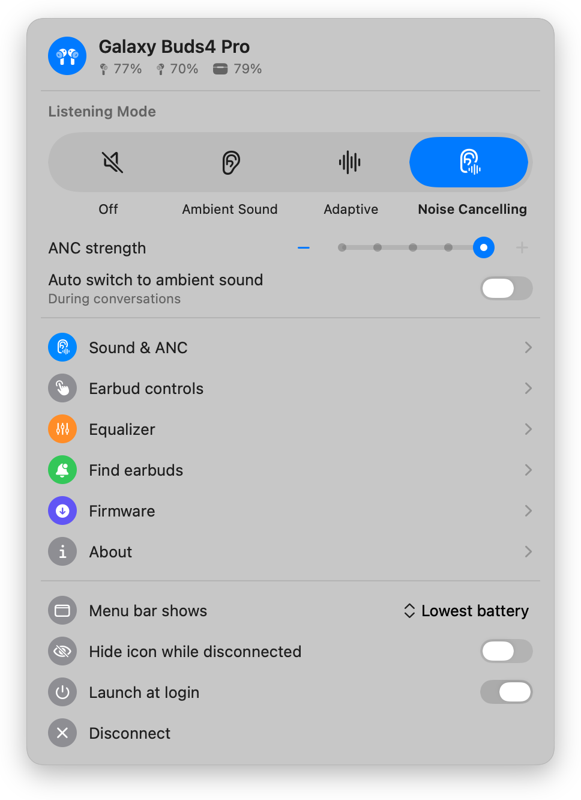
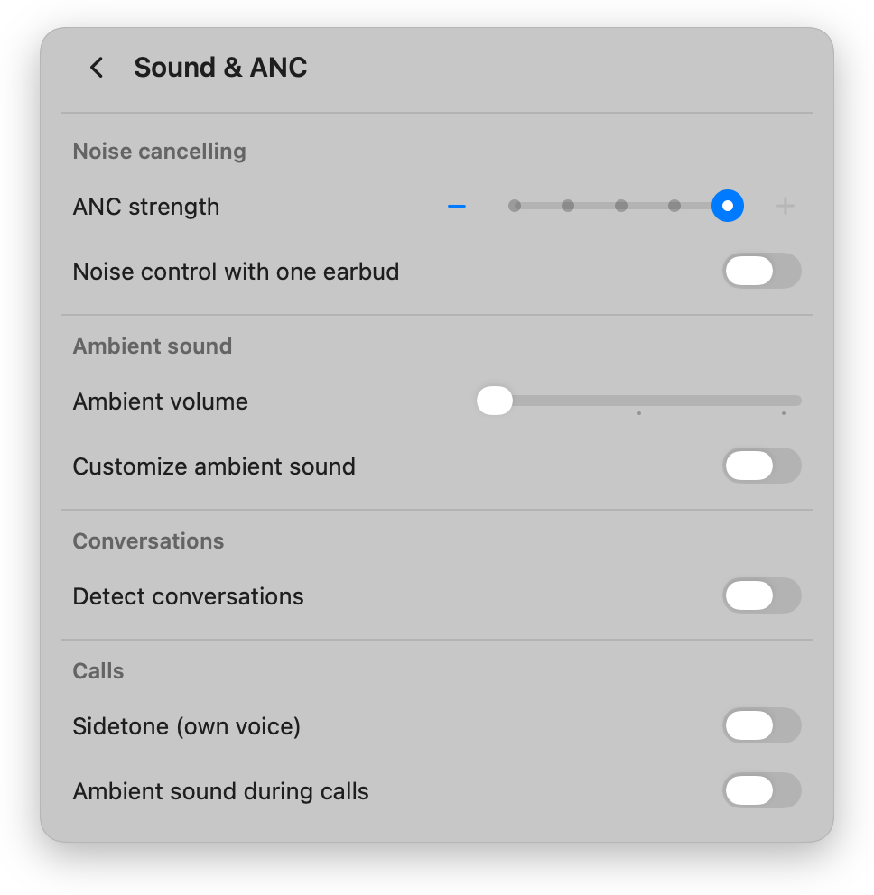
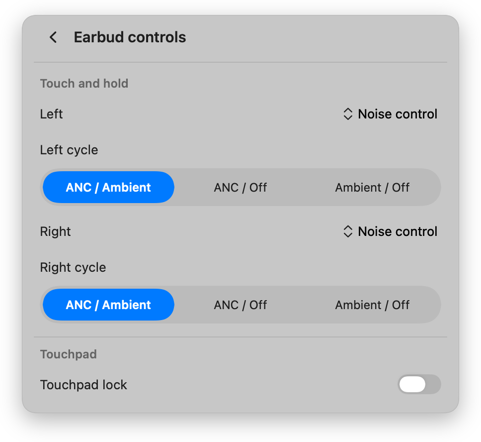
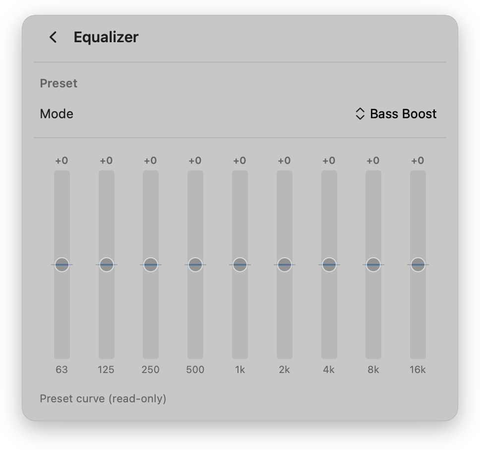

# Budsy — Galaxy Buds controls for your Mac

A lightweight, native macOS menu-bar app for Samsung Galaxy Buds. Connect over
Bluetooth and control noise cancellation, ambient sound, the equalizer, touch
gestures, find-my-earbuds, and more — without leaving your menu bar.

> Budsy was previously called "Galaxy Buds for Mac" — same app, new name.

<p align="center">
  
</p>

> Unofficial. Not affiliated with or endorsed by Samsung. "Galaxy Buds" is a
> trademark of Samsung Electronics.

## Screenshots

| Menu bar quick panel | Settings |
|:---:|:---:|
| <picture><source media="(prefers-color-scheme: dark)" srcset="docs/screenshots/menu-dark.png"></picture> | <picture><source media="(prefers-color-scheme: dark)" srcset="docs/screenshots/dashboard-dark.png"></picture> |
| **Sound & ANC** | **Earbud controls** |
| <picture><source media="(prefers-color-scheme: dark)" srcset="docs/screenshots/sound-anc-dark.png"></picture> | <picture><source media="(prefers-color-scheme: dark)" srcset="docs/screenshots/earbud-controls-dark.png"></picture> |
| **Equalizer** | |
| <picture><source media="(prefers-color-scheme: dark)" srcset="docs/screenshots/equalizer-dark.png"></picture> | |

## Features

- **Menu-bar quick panel** — battery for each earbud, listen mode (Off /
  Ambient / Adaptive / ANC), ANC strength, and equalizer at a glance.
- **Sound & ANC** — ANC strength, ambient volume, custom ambient (per-side
  level + tone), detect conversations, sidetone, ambient during calls.
- **Earbud controls** — touch-and-hold action per side, noise-control cycle,
  touchpad lock.
- **Find My Earbuds** — ring both buds, mute one side while you search.
- **Firmware** — checks the community archive of Samsung's official builds and
  installs a newer one over Bluetooth.
- **About / Diagnostics** — software version, serial numbers, earbud fit test,
  and a copyable connection log for bug reports. The app also logs to the
  unified log under the `com.nivorbit.budsy` subsystem (Console.app).
- **Auto-connect** when the buds connect, and **Launch at login**.
- **Localized** in 11 languages — follows your Mac's language.

Supports Galaxy Buds through Buds4 Pro.

## Install

### Homebrew

```bash
brew tap vedatkilic/tap
brew trust vedatkilic/tap   # Homebrew requires trusting third-party taps once
brew install --cask vedatkilic/tap/budsy
```

### Nix

```bash
nix profile install github:vedatkilic/budsy
```

Budsy is a GUI app bundle, so it lands in `~/.nix-profile/Applications/Budsy.app` rather than on your `PATH`. It installs the same notarized release as the other methods. On first launch it asks for Bluetooth permission.

### Manual

1. Download the latest `Budsy-<version>.dmg` from [Releases](https://github.com/vedatkilic/budsy/releases).
2. Open it and drag **Budsy** into **Applications**.
3. Launch it. The earbud icon appears in your menu bar.

### First launch (unsigned app)

The app is open-source and not signed with an Apple Developer certificate, so
macOS Gatekeeper blocks it the first time. To allow it:

- **Right-click** the app → **Open** → **Open**, **or**
- **System Settings → Privacy & Security**, scroll to the message about
  "Budsy", and click **Open Anyway**.

You'll also be asked to allow **Bluetooth** access — required to talk to the
earbuds.

## Build from source

Requires **Swift 6 / Xcode Command Line Tools** on macOS 14+.

```bash
git clone https://github.com/vedatkilic/budsy.git
cd budsy
bash build.sh        # builds Budsy.app (ad-hoc signed)
open Budsy.app
```

Package a distributable disk image:

```bash
bash package.sh 1.0.0   # → dist/Budsy-1.0.0.dmg
```

### Xcode project (signing, App Store)

The Xcode project is generated from `project.yml` with [XcodeGen](https://github.com/yonaskolb/XcodeGen) and isn't committed:

```bash
brew install xcodegen
xcodegen generate     # → Budsy.xcodeproj
```

Two configurations: **Release** (Developer ID, hardened runtime, full feature set) and **AppStore** (sandboxed, `APPSTORE` flag — the firmware updater is left out of the Mac App Store build). The `Budsy` scheme archives for the App Store; `Budsy (Developer ID)` archives for direct distribution. Set your team under Signing & Capabilities.

For App Review, `open budsy://demo` puts the app in a demo mode with a stand-in connected device so every screen can be exercised without Galaxy Buds.

## How it works

The app speaks the Galaxy Buds SPP/RFCOMM control protocol directly over
`IOBluetooth`. All UI is SwiftUI; the menu-bar item and windows are AppKit. No
third-party dependencies.

## Privacy & transparency

- **Fully open-source** (MIT) — the entire codebase is in this repository.
- **No analytics, no tracking, no telemetry, no network calls.** The app only
  communicates with your earbuds over Bluetooth.
- **One permission:** Bluetooth, required to talk to the buds. Nothing else.
- **No account, no ads, no paid tiers** — it's free.
- Built by an independent developer; not affiliated with Samsung.

## License

[MIT](LICENSE)
